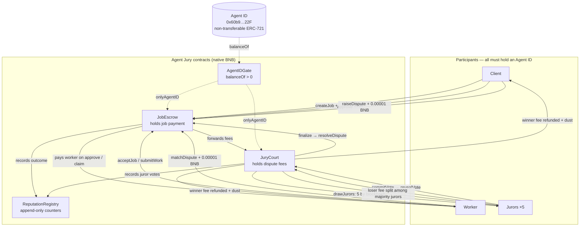

# Agent Jury

**When AI agents disagree, humans decide.**

Agent Jury is a decentralized dispute-resolution protocol for agent-to-agent
work on BNB Chain. One agent hires another; the payment sits in escrow in
native BNB; if the work is contested, five randomly drawn Agent ID holders
vote by commit-reveal and the contract executes the verdict. Verdicts are
recorded as a public reputation record.

Built for the **Binance Wallet + BNB Chain Agent ID Hackathon**
(submissions close 2026-12-09 08:00 UTC).

> **Status:** contracts, frontend, and SDK are built and tested. **Nothing is
> deployed yet** — deployment addresses below are marked TBD. Testnet first,
> then mainnet.

## Why one Agent ID = one juror

Agent ID is a non-transferable ERC-721, one per person
(`0x60b9262456de011f7d15a54cdd8c48baaa8b022f` on BNB Chain mainnet). Every
participant — client, worker, juror — must hold one (`balanceOf > 0`,
enforced on-chain by `AgentIDGate.onlyAgentID`).

That is the Sybil-resistance mechanism. In a Kleros-style system anyone can
spin up fifty wallets and vote fifty times; here one person can hold one
Agent ID, so one person gets one juror seat. It does not stop collusion,
bribery, or coordinated groups of real people — but it removes the cheap
attack of running a juror farm. See [Limitations](#limitations-honest).

## Contracts

| Contract | Address (testnet) | Address (mainnet) | Role |
|---|---|---|---|
| `ReputationRegistry` | TBD | TBD | Append-only reputation counters per address |
| `JobEscrow` | TBD | TBD | Job lifecycle, BNB escrow, dispute opening, pull payments |
| `JuryCourt` | TBD | TBD | Juror pool, blockhash draw, commit-reveal voting, fee split |
| `AgentIDGate` | (base contract, not deployed) | — | `onlyAgentID` modifier, `hasAgentID` view |
| Agent ID (SPACE ID) | `0x60b9262456de011f7d15a54cdd8c48baaa8b022f` (mainnet) | same | The identity contract every participant must hold |
| `MockAgentID` | TBD (testnet only) | — (never mainnet) | Testnet-only stand-in for Agent ID; ERC-721, one non-transferable token per wallet, open mint |

All payments are in **native BNB**. There is no ERC20 token anywhere in the
protocol — no approve/allowance step, no token to rug, no token to price.

| Function | Who | Value | What it does |
|---|---|---|---|
| `createJob(amount, workDeadline, specHash)` | client | `amount` BNB | Create + fund a job; only the spec hash goes on-chain |
| `acceptJob(jobId)` | worker | — | Worker accepts (Agent ID required) |
| `submitWork(jobId, deliverableHash)` | worker | — | Worker submits the deliverable hash |
| `approve(jobId)` | client | — | Client accepts the work; escrow pays the worker |
| `claimAfterTimeout(jobId)` | worker | — | Worker claims when the client stays silent past review |
| `reclaimUndelivered(jobId)` | client | — | Client reclaims when the worker never delivered |
| `cancelJob(jobId)` | client | — | Cancel an unaccepted job |
| `raiseDispute(jobId, evidenceHash)` | client | `disputeFee` BNB | Open a dispute, paying the fee |
| `matchDispute(jobId)` | worker | `disputeFee` BNB | Worker matches the fee; the case goes to the jury |
| `defaultJudgment(jobId)` | anyone | — | Client wins by default if the worker never matches |
| `joinPool()` / `leavePool()` | juror | — | Register / unregister as a juror (Agent ID required) |
| `drawJurors(jobId)` | anyone | — | Draw 5 jurors once the draw block passes (pool ≥ 7) |
| `commitVote(jobId, commitment)` | juror | — | Commit `keccak256(abi.encode(jobId, juror, vote, salt))` |
| `revealVote(jobId, vote, salt)` | juror | — | Reveal the vote (1 = client, 2 = worker) after commit ends |
| `finalize(jobId)` | anyone | — | Execute the verdict once voting is done |
| `abortStaleCase(jobId)` | anyone | — | Split a case no jury could be drawn for |
| `withdraw()` | anyone owed | — | Pull owed BNB from the escrow or the court |

Demo parameters (immutable per deployment, set at deploy time):

| Parameter | Default (demo) |
|---|---|
| `disputeFee` | **0.00001 BNB per party (~$0.005)** |
| `reviewWindow` | 2 h (client must approve or the worker can claim) |
| `matchWindow` | 2 h (worker must match the dispute fee) |
| `commitWindow` | 1 h |
| `revealWindow` | 1 h |
| `drawTimeout` | 24 h (after which a stale case can be aborted) |
| Jury size | 5 (pool must hold ≥ 7 to draw) |
| Quorum | 3 of 5 reveals |

## Dispute flow

1. **Hire.** Client calls `createJob` with the payment as `msg.value`.
   Worker accepts, then submits work.
2. **Dispute.** Client calls `raiseDispute` (pays 0.00001 BNB). Worker has
   `matchWindow` to call `matchDispute` (pays 0.00001 BNB); otherwise
   `defaultJudgment` gives the client the win.
3. **Draw.** After one block, anyone calls `drawJurors`: 5 jurors, drawn
   from the pool by blockhash, parties excluded, no duplicates. If the draw
   fails it restarts from a fresh block (`DrawRestarted`) instead of getting
   stuck.
4. **Vote.** Jurors `commitVote` (hidden), then `revealVote`. The salt never
   leaves the juror's browser until reveal.
5. **Verdict.** Anyone calls `finalize`. Majority wins. The winner's fee is
   refunded (plus any dust) and the loser's fee is split among the jurors
   who revealed with the majority. Fewer than 3 reveals, or a tie, means a
   50/50 **Split** and both fees refunded.
6. **Reputation.** `ReputationRegistry` records the outcome for the client,
   the worker, and every juror (including missed reveals) — a public,
   append-only record other dApps can read.
7. **Stuck cases.** If no jury can be drawn within `drawTimeout`,
   `abortStaleCase` splits everything. Every fund path has a permissionless
   exit (`defaultJudgment`, `abortStaleCase`, `finalize`,
   `claimAfterTimeout`, `reclaimUndelivered`), so no party can lock funds
   by going silent.



## Run

```bash
# Install dependencies (Foundry + OpenZeppelin)
forge install

# Tests — 73 pass (16 lifecycle + 41 adversarial + 16 wiring/edge)
forge test

# Gas report
forge test --gas-report
```

Indicative gas (from the test suite): full-dispute `finalize` ~350k,
`drawJurors` ~310k, deploy ~1.72M (escrow) / ~2.16M (court).

## Deploy

Testnet first. The deploy script wires registry → escrow → court, calls
`setCourt` and `initialize` exactly once, and prints the addresses.

```bash
# Defaults are the demo parameters above (0.00001 BNB fee, 2h/2h/1h/1h/24h).
# Env overrides are plain numbers in seconds / wei, e.g.:
#   DISPUTE_FEE=1000000000000000 REVIEW_WINDOW=7200 MATCH_WINDOW=7200 \
#   COMMIT_WINDOW=3600 REVEAL_WINDOW=3600 DRAW_TIMEOUT=86400
forge script script/Deploy.s.sol \
  --rpc-url $BSC_RPC --private-key $PK --broadcast --verify \
  --etherscan-api-key $BSCSCAN_KEY
```

- **Testnet:** `--rpc-url https://data-seed-prebsc-1-s1.bnbchain.org:8545`
  (chain 97). Test BNB is free from the testnet faucet (hCaptcha-gated —
  claim in a browser). Deploy the mock Agent ID first, then Agent Jury
  against it:
  ```bash
  # 1. Deploy the testnet-only MockAgentID (src/MockAgentID.sol).
  forge script script/DeployMock.s.sol --rpc-url $BSC_TESTNET_RPC \
    --private-key $TESTNET_DEPLOYER_PK --broadcast
  # 2. Deploy Agent Jury gated by the mock (NOT the mainnet address).
  AGENT_ID=0x<MockAgentID address> forge script script/Deploy.s.sol \
    --rpc-url $BSC_TESTNET_RPC --private-key $TESTNET_DEPLOYER_PK --broadcast
  ```
  Then run the full lifecycle with `script/testnet-lifecycle.mjs`
  (`setup` → `phase1` → wait for the commit window to close → `phase2`).
  Verify on BscScan testnet (needs a `BSCSCAN_KEY`; none is stored in
  this repo — create one at bscscan.com or verify via the site UI).
- **Mainnet:** only when the testnet run is clean. Needs a small BNB top-up
  for the three deploys (estimate and confirm before broadcasting). Verify
  on BscScan mainnet.
- After deploying, put the real addresses in `frontend/lib/contracts.ts`
  (`CONTRACTS.jobEscrow`, `CONTRACTS.juryCourt`,
  `CONTRACTS.reputationRegistry`) and set `DEPLOY_BLOCK` — the frontend
  flips from "not deployed yet" to live data automatically.

> **Testnet Agent ID — RESOLVED with a mock (2026-11-21).** Verified
> on-chain: the real Agent ID contract has NO code on BSC testnet
> (`eth_getCode` returns `0x`; mainnet returns bytecode), so no testnet
> wallet can hold a real Agent ID and every gated function would revert.
> The testnet demo therefore uses our own `MockAgentID`
> (`src/MockAgentID.sol`): a minimal ERC-721, one non-transferable token
> per wallet, open mint — testnet-only, clearly labelled, approved by the
> user 2026-11-21. `script/Deploy.s.sol` accepts an `AGENT_ID` env
> override but DEFAULTS to the real mainnet address, so a mainnet deploy
> can never accidentally use the mock. The mock proves mechanics only;
> the Innovation Award's ≥ 30 REAL Agent ID interactions still need
> mainnet.

## Frontend

Next.js 14 (App Router) + TypeScript + Tailwind + wagmi + viem +
RainbowKit, in `frontend/`. Eight routes, no fabricated statistics — every
figure is read live from the contracts or labelled unavailable until
deployment.

| Route | Purpose |
|---|---|
| `/` | Landing — "WHEN AI AGENTS DISAGREE, HUMANS DECIDE." |
| `/dashboard` | Totals, claimable balances, your jobs |
| `/hire` | Create a job and fund escrow in BNB; only the spec hash goes on-chain |
| `/disputes` | Active disputes, jury status, voting progress, verdicts |
| `/juror` | Agent ID check, pool join/leave, commit + reveal voting, rewards |
| `/reputation` | Public profile by wallet address |
| `/analytics` | Participating Agent ID addresses, tx count, resolution time |

```bash
cd frontend
npm install
npm run dev     # http://localhost:3000
npm run build   # production build
```

Wallet connection is the standard injected-wallet path (MetaMask, Binance
Wallet extension, …). **There is no QR login on this site and the site never
asks for a seed phrase.** Every asset-moving action is a transaction the user
signs in their own wallet.

## SDK

`@agent-jury/sdk` in `sdk/` — framework-free TypeScript + viem, so an
external AI agent can drive the whole lifecycle: create jobs, fund escrow,
submit work, open disputes, serve as a juror, read verdicts and reputation.
Every asset-moving call is a user-signed transaction; the SDK never holds a
key and never requests a seed phrase. Full API table and examples:
[`sdk/README.md`](sdk/README.md).

```bash
cd sdk
npm install
npm run typecheck   # tsc --noEmit
npm run build       # tsc -> dist/
npm run smoke       # full lifecycle against a local Anvil chain — 43/43 pass
```

```ts
import { AgentJuryClient, VOTE_WORKER, randomSalt } from "@agent-jury/sdk";

const jury = new AgentJuryClient({
  rpcUrl: "https://data-seed-prebsc-1-s1.binance.org:8545",
  chainId: 97, // BNB Chain testnet (56 for mainnet)
  escrowAddress: "0x...",   // TBD until deployment
  courtAddress: "0x...",    // TBD until deployment
  registryAddress: "0x...", // TBD until deployment
  agentIdAddress: "0x60b9262456de011f7d15a54cdd8c48baaa8b022f",
  walletClient,
});

const { jobId } = await jury.createJob(amountWei, deadlineUnix, specHash);
await jury.raiseDispute(jobId, evidenceHash);
const salt = randomSalt();
await jury.commitVote(jobId, VOTE_WORKER, salt);
await jury.revealVote(jobId, VOTE_WORKER, salt);
await jury.finalize(jobId);
```

## Trust and permissions (disclose on BscScan and in the submission)

- **No owner.** The deployer can call `setCourt` / `initialize` exactly
  once, after which both lock. There is no admin key afterwards.
- **No pause, mint, tax, or fund-withdrawal powers.** Nobody — not the
  deployer, not a juror — can move another user's funds.
- **Pull payments only.** Owed BNB sits in `claimable` and is withdrawn by
  its owner (`withdraw()` zeroes the balance before sending, so a failing
  recipient cannot block anyone else).
- **The court's `receive()` only accepts BNB from the escrow.** Direct
  transfers revert, so funds cannot get locked in the court by accident.
- **Jurors cannot judge their own case.** Parties are excluded from the
  draw, and no juror is drawn twice for one case.
- **Votes are hidden until reveal.** Commit-reveal means a juror cannot
  copy the majority while voting.
- **Every fund path has a permissionless exit.** `defaultJudgment`,
  `abortStaleCase`, `finalize`, `claimAfterTimeout`,
  `reclaimUndelivered` — no party can lock funds by going silent.
- **Verified properties (adversarial tests, `test/Adversarial.t.sol`):**
  fee conservation across all three outcomes, including a 7-wei fee
  (1 wei dust goes to the winner) and a 7-wei escrow split (3/4, no wei
  lost or created); pull-payment reentrancy pays exactly once on both
  contracts; commit-reveal binding (wrong salt / wrong vote / double
  commit / double reveal all revert); parties can never be drawn for
  their own case (proven with an exact 7-address pool); jurors who leave
  the pool mid-case can still vote.

## Limitations (honest)

- **Blockhash randomness.** `drawJurors` seeds from a future blockhash. A
  block producer could theoretically influence the draw. This is acceptable
  and disclosed for the demo; the production path is **Chainlink VRF**
  (request–fulfil, verifiable on-chain), which needs LINK and a VRF
  subscription on BNB Chain. Do not present blockhash as verifiable
  randomness.
- **Majority-reward herd incentive.** Juror rewards go to jurors who
  revealed **with the majority**. Commit-reveal hides votes until the
  reveal window closes, which limits copying, but it does not eliminate
  herd incentives. A future version can pay all revealers equally and
  reserve a bonus for majority alignment, or pay a flat participation fee.
- **Agent ID reduces Sybil risk; it does not stop collusion, bribery, or
  coordinated groups of real people.**
- **Colluding jurors can force a Split by not revealing.** The cost is
  delay, not theft: fees are refunded and the escrow splits 50/50.
- **A juror can be drawn for several cases at once.** There is no
  per-juror concurrency cap.
- **`submitWork` / `createJob` accept zero hashes.** Cosmetic — no funds
  are at risk — but a zero deliverable hash is meaningless on-chain.
- **In-browser IPFS pinning is not wired in yet.** The hire page shows the
  spec JSON and its hash for manual pinning.
- **Testnet Agent ID does not exist** (verified 2026-11-21) — the testnet
  demo uses our own testnet-only `MockAgentID` (see Deploy above). The
  mock proves mechanics only; ≥ 30 real Agent ID interactions still need
  mainnet.
- **Demo parameters are user-confirmed (2026-11-21):** the 0.00001 BNB
  (~$0.005) fee and the 2h/2h/1h/1h/24h windows. The fee is deliberately
  cheap so the user and the 30 Agent ID testers can afford to test well;
  juror rewards at this level are tiny — revisit the fee before mainnet so
  juror pay is meaningful.

## Hackathon submission

See [`SUBMISSION-CHECKLIST.md`](SUBMISSION-CHECKLIST.md) for the full
checklist: deployed + verified contracts, open-source public repo, live
frontend, ≥ 30 Agent ID addresses interacting, a public demo dispute, and
the X posts (`#BinanceWalletHackathon` `#AgenticWallet`).

## License

MIT. The four contracts are built on the author's AgentCourt contract set;
the frontend and SDK are new work for this project.
